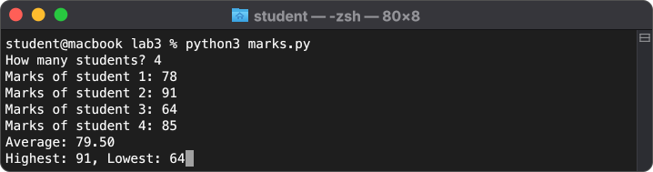
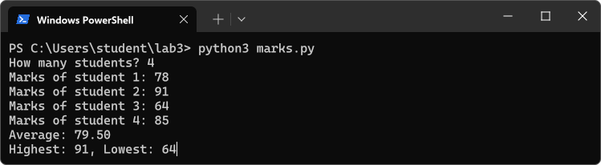
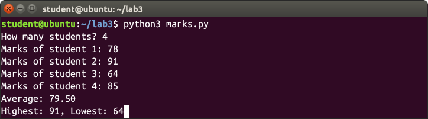
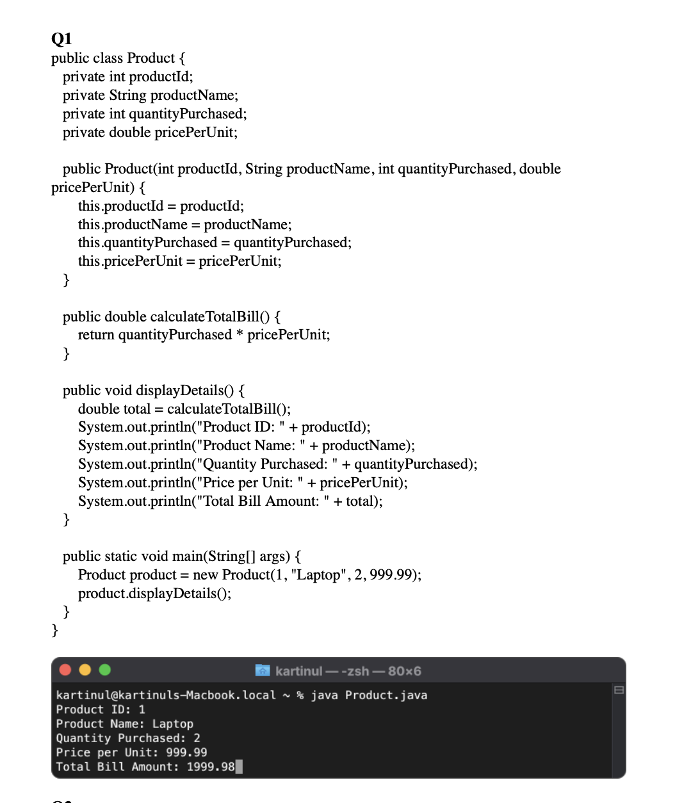
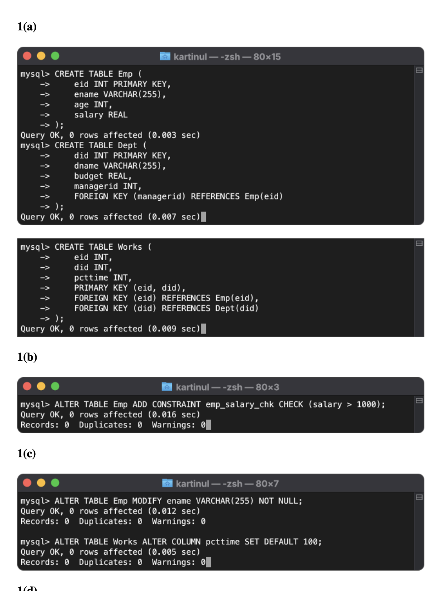
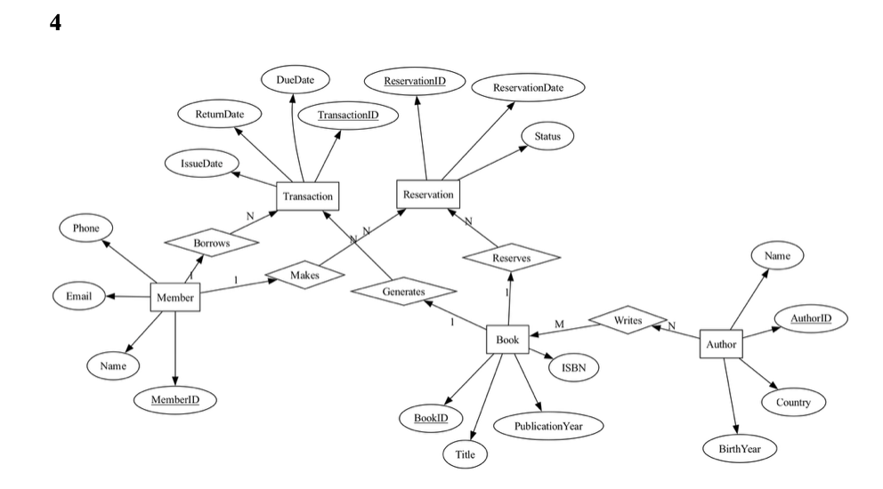

# savecodex

savecodex runs every code file in a folder, has AI write the input each one needs, types it in, screenshots the terminal and packs code and screenshots into a DOCX.
Point it at a folder and it uses the agent CLI you already have (`claude`, `codex`, ...) or a Gemini API key.

▶ [Watch the demo video](https://youtu.be/4t4ck5AG-Kg)

<p align="center">
  
  
  
</p>

It can also solve a whole assignment: give it the PDF and it writes the answers, runs them and packs them the same way.

<p align="center">
  
  
  
</p>

## Installation

Grab a binary from [Releases](https://github.com/kartinul/savecodex/releases/latest):

```bash
curl -Lo savecodex https://github.com/kartinul/savecodex/releases/latest/download/savecodex-macos-arm64
chmod +x savecodex
```

Other builds: `savecodex-macos-amd64`, `savecodex-linux-amd64`, `savecodex-windows-amd64.exe`.

Or build it yourself (needs Rust and [bun](https://bun.sh)) with `make build`, or use Docker (`Dockerfile` / `render.yaml`).
Your code runs with the compilers on your machine, so have the ones you need (`python3`, `gcc`, `java`, ...).

## AI

You don't need an API key if you already have an agent CLI logged in. savecodex uses the first one on your `PATH`:
`claude`, `codex`, `gemini`, `cursor-agent`, `opencode`, `copilot`, `qwen`, `amp`, `agy`. If one fails mid run (usage limit, logged out) the next one takes over.

| Want | Do |
|---|---|
| a specific one | `-p codex` |
| fully local, nothing leaves your machine | `--local` (Ollama, first installed model) |
| Gemini API | `GEMINI_API_KEY` ([free key](https://aistudio.google.com/app/apikey)) |
| any OpenAI compatible API (Groq, OpenRouter, LM Studio, ...) | `SMART_PROVIDER=openai` with `SMART_BASE_URL`, `SMART_API_KEY`, `SMART_MODEL` |

The work is split into 3 tiers: SMART reads the assignment (`solve`), MID solves it, FAST writes program input. An unset tier falls back to the one above, so you can mix them:

```bash
savecodex solve hw.pdf -p claude --fast-provider ollama
```

`solve` sends PDF pages as images, so pick a vision model if you run it locally.
Put your settings in `.env` (`cp .env.example .env`), `./apitest` checks your Gemini/OpenAI keys.

## Usage

```bash
savecodex serve                       # web UI on http://localhost:7878
savecodex solve lab7.pdf records.txt  # → lab7_solved.docx
savecodex pack lab5                   # → lab5_pack.docx
```

### `serve`

A web UI for both `solve` and `pack`: drop files, watch every question or file get written, run and screenshotted live, then download the DOCX. Everyone uses the server's AI config; users can paste their own OpenAI-compatible key, base URL and model instead (https only, public addresses only).

| Option | Default | |
|---|---|---|
| `--port` | `7878` | |
| `--host` | `127.0.0.1` | |
| `--debug` | off | Debug logging |

Also takes the AI flags (`-p`, `--local`, `--fast-model`, ...).

### `solve`

Reads questions from PDFs, DOCX files and images, solves them, runs every answer and writes a DOCX. An answer is code with its terminal screenshot, SQL or commands typed into a real `mysql>` / `$` session, a picture (ER/UML diagram, chart or web page) or just a written answer.

```bash
savecodex solve lab7.pdf records.txt      # records.txt gets copied next to the answers
savecodex solve week*.pdf -o "{}_answers" # one DOCX per PDF
```

| Option | Default | |
|---|---|---|
| `<inputs...>` | required | PDF/DOCX/images, other files get copied next to the answers |
| `-o, --output` | `<input>_solved` | Needs `{}` when solving several PDFs/DOCX |
| `--questions` | off | Print each question above its answer |
| `--max-pages` | `60` | Refuse longer PDFs |
| `--check [CONFIDENCE]` | off | SMART grades every run, diagram and written answer and redoes the ones it calls bad at least this sure (`0.7` when given alone) |
| `--level` | `3` | How professional the code looks: `1` careless student, `3` student in a hurry, `5` clean code |
| `--instructions` | none | Your own instructions for the AI (`"use Java"`, `"comment every line"`), they win over savecodex's rules |

Also takes the [document options](#document-options) below. Needs poppler (`pdftotext`, `pdftoppm`), plus `mysql`, graphviz (`dot`), matplotlib or Chrome for the answers that use them (with `--linux` the container has them). AI written code runs on your machine unless you pass `--linux`.

MySQL answers run in databases of their own: each session starts in a fresh one, every database an answer creates, uses or drops gets a hidden prefix (removed again in the screenshots), and all of them are dropped when the session ends, so existing databases are never touched.

### `pack`

Runs every code file in the given files/folders, with AI input for the ones that read stdin, and writes one DOCX per folder. A file that fails still goes in, with its error in the screenshot.

```bash
savecodex pack lab5 -o "roll42_{}" --doc-title "Assignment {}"
savecodex pack lab5 lab6 lab7 -o "{}_final"
```

| Option | Default | |
|---|---|---|
| `<paths...>` | required | Files or folders to pack |
| `-r, --recursive` | off | Include subfolders |
| `--ext` | most common supported extension | e.g. `java,py` |

### Document options

For `pack` and `solve`.

| Option | Default | |
|---|---|---|
| `-o, --output` | `<folder>_pack` / `<input>_solved` | Output name, `{}` is the folder or input name (needed with several of them) |
| `--doc-title` | folder or input name | Heading, supports `{}` |
| `--doc-text` | none | Text under the heading, supports `{}` |
| `--page-break` | off | Page break after each file |
| `--doc-theme` | `current` | How the document looks: `current`, `word`, `word calibri`, `word 2010`, `academic`, `modern`, `lab record`, `compact`, `typewriter`, `elegant` or a theme `.json` file (fields it leaves out keep the current look) |
| `--numbering` | the theme's | Sub-part numbering: `1(b)(i)`, `1(2)(1)`, `1.b.i` or `1.2.1` |
| `--full-labels` | off | Head sub-parts with their whole label (`1(b)(i)`) instead of only their own part (`(i)`) |
| `--ai-input` | `auto` | `auto`: only files that read stdin (`input(`, `scanf`, `Scanner`, ...), `always` or `never` |
| `--no-trim` | off | Keep long output (default trims to 150 lines × 200 chars, hard cap 1000 × 300) |
| `-j, --jobs` | `15` | Files (`pack`) or question groups (`solve`) at once |
| `--linux` | off | Run code in a throwaway Linux container, one per document (Apple `container` on macOS, else Docker; never installs either). The image builds on first use. Screenshots default to `--style ubuntu` |

### Screenshot options

For `pack`, `solve` and `term`.

| Option | Default | |
|---|---|---|
| `--style` | `windows` | `windows`, `macos` or `ubuntu` |
| `--theme` | `dark` | `dark` or `light` |
| `--username` | current user | |
| `--hostname` | this machine | |
| `--cwd` | current directory | |
| `--messy` | `0` | Realistic imperfections, `0` to `3` |
| `--seed` | derived from the text | Fixes `--messy` randomness |
| `--banner` | off | PowerShell startup banner (windows style) |
| `--min-cols` | `80` | Minimum window width in columns |
| `--prompt` | `"$ "` | Lines starting with this get the styled prompt |
| `--no-prompt-highlight` | off | Don't style `--prompt` lines |

### `term` / `run`

`term` renders one screenshot (`term.png`) from a run or from text, `run` prints a run's transcript.

```bash
savecodex term --runfile main.py -i 5 --style macos
savecodex term --text-file output.txt --no-prompt
savecodex run main.py -i 5 -o out.txt
```

## Languages

Python, C, C++, Java, JavaScript, Rust and shell scripts work out of the box; `solve` also knows MySQL and shell sessions, Graphviz diagrams (`dot`), web pages (`html`) and matplotlib charts (`plot`). Add or change languages in `languages.json` in your config dir (`~/Library/Application Support/savecodex/` on macOS) or the folder you run from. Each language merges field by field over the [defaults](crates/app/src/default_languages.json):

```json
{
  "go": {
    "run": ["go", "run", "{file}"],
    "stdin": ["fmt.Scan", "os.Stdin"]
  }
}
```

`build`/`run` take `{file}`, `{dir}` and `{file_stem}` and can be overridden per OS (`windows`/`macos`/`linux`; `--linux` uses `linux`). `stdin` is what tells `--ai-input auto` the program reads input. `hint` is advice for the AI when it writes that language. Session languages (`session: true`) also take `prompts`, `reset`/`cleanup` commands run before and after each session, and `namespace`: keywords whose next name gets the session's `{ns}` prefix.

## Sandboxing

- **Everywhere:** only allowlisted env vars reach the program, so `.env` secrets stay hidden. Builds time out after 30s, runs after 5s.
- **Linux:** `prlimit` limits CPU, processes, file size and memory. `bwrap` (if installed) adds read-only system dirs, no home and a private `/tmp`.
- **Linux server as root** (Docker/Render): each job runs as its own throwaway uid, `scripts/sandbox-firewall.sh` blocks LAN/metadata access.
- **macOS/Windows:** only the env allowlist and timeouts, so run only code you trust, or use `--linux`.
- **`--linux`:** code runs in a throwaway container that only sees the job's folder; it's removed when the document is done.

## Environment Variables

Read from the shell or the first `.env` in the current directory or a parent. CLI flags win.

### AI

| Variable | Default | |
|---|---|---|
| `SMART_PROVIDER` | auto detect | `-p`. `gemini`, `openai`, `ollama`, `claude`, `codex`, `gemini-cli`, `cursor`, `opencode`, `copilot`, `qwen`, `amp`, `antigravity` |
| `MID_PROVIDER` / `FAST_PROVIDER` | tier above | |
| `PROVIDER`, `MODEL`, `THINKING`, `API_KEY`, `BASE_URL` | none | Shorthand for every tier without its own `{TIER}_` key |
| `{TIER}_MODEL` | see below | Comma separated Gemini models fall back in order |
| `{TIER}_THINKING` | provider default | `off`, `low`, `medium`, `high`, `xhigh` (Gemini, OpenAI/Ollama, claude, codex) |
| `{TIER}_API_KEY`, `{TIER}_BASE_URL` | none | Needed for `openai` |
| `GEMINI_API_KEY` | none | Gemini key, also the last fallback after agent CLIs |
| `OLLAMA_HOST` | `http://localhost:11434` | |
| `SAVECODEX_LOCAL` | off | `--local` |
| `SAVECODEX_RETRIES` | `5` | `--retries` for a failed AI call |
| `SAVECODEX_AGENT_JOBS` | no limit | Max calls at once per agent CLI |

Every tier setting also has a flag (`--mid-provider`, `--fast-model`, ...). Default models:

| Provider | SMART | MID | FAST |
|---|---|---|---|
| `gemini` | `gemini-3.6-flash` | `gemini-3.5-flash` | `gemini-3.5-flash-lite` |
| `claude` | `opus` | `sonnet` | `haiku` (low effort) |
| `gemini-cli` | `pro` | `flash` | `flash-lite` |
| `antigravity` | newest `pro` / `flash-high` | newest `flash-medium` | newest `flash-low` |
| others | CLI default | CLI default | CLI default (low effort on codex) |

Each Gemini default falls back to the next smaller model.

### CLI defaults

Each one sets the default of its flag, described in the tables above.

| Variable | Flag | Default |
|---|---|---|
| `SAVECODEX_STYLE` | `--style` | `windows` |
| `SAVECODEX_OUTPUT` | `-o` | `<folder>_pack` / `<input>_solved` |
| `SAVECODEX_DOC_TITLE` | `--doc-title` | folder or input name |
| `SAVECODEX_DOC_TEXT` | `--doc-text` | none |
| `SAVECODEX_DOC_THEME` | `--doc-theme` | `current` |
| `SAVECODEX_NUMBERING` | `--numbering` | the theme's |
| `SAVECODEX_FULL_LABELS` | `--full-labels` | off |
| `SAVECODEX_AI_INPUT` | `--ai-input` | `auto` |
| `SAVECODEX_NO_TRIM` | `--no-trim` | off |
| `SAVECODEX_JOBS` | `-j` | `15` |
| `SAVECODEX_LINUX` | `--linux` | off |
| `SAVECODEX_EXT` | `--ext` | most common supported extension |
| `SAVECODEX_CHECK` | `--check` | off |
| `SAVECODEX_LEVEL` | `--level` | `3` |
| `SAVECODEX_INSTRUCTIONS` | `--instructions` | none |

## Development

```bash
make dev                          # frontend on :5173, backend on :7878, both auto reload
make build                        # ./target/release/savecodex
python3 scripts/readdocx.py *.docx  # dump generated docx as text, OCRs the screenshots
```

Pushing a `v*.*.*` tag builds the release binaries.
